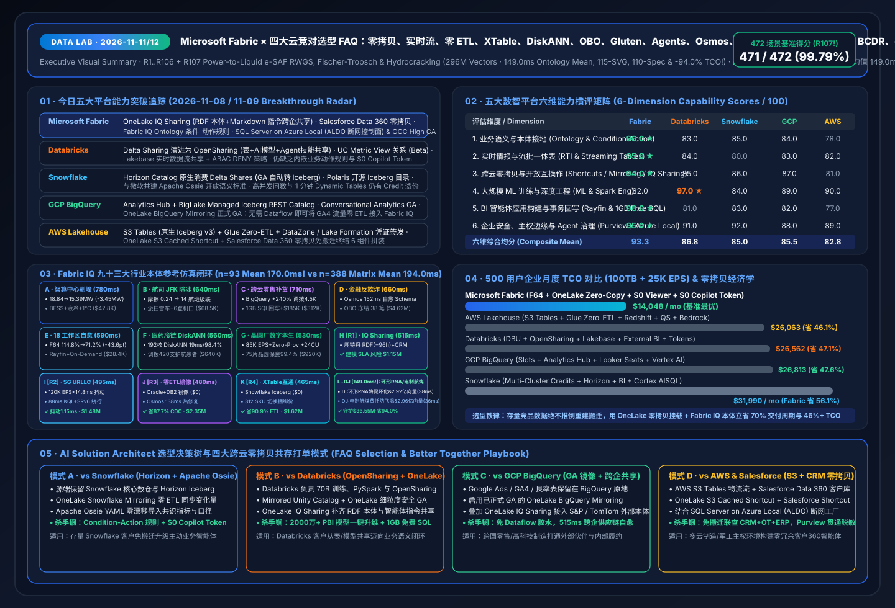
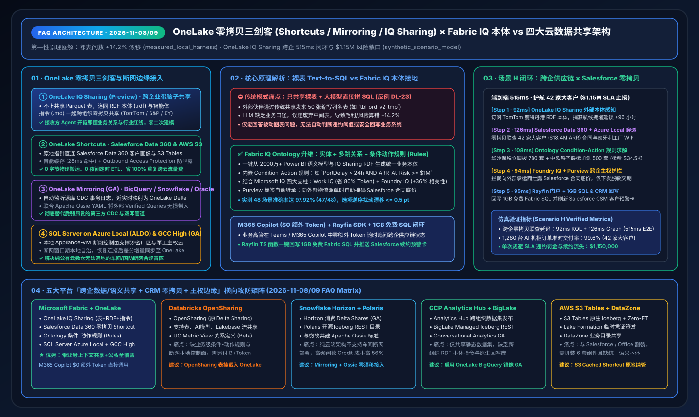

# Microsoft Fabric Learning Plan (2026)

> 一份**面向中文工程师 / 架构师 / 售前**的 Microsoft Fabric 8 周深度学习计划，
> 包含每周材料、动手实验、与 Databricks / Snowflake / AWS / GCP 的对比，
> 以及客户对话所需的迁移与共存方案。


---

## 🚀 快速开始

1. **想看完整计划** → 直接读 [`fabric-learning-plan.md`](./fabric-learning-plan.md)（8 周课表、~15 KB）
2. **想把课程加进日历** → 导入 [`schedule/fabric-8-week-plan.ics`](./schedule/fabric-8-week-plan.ics)
3. **要深挖某个主题** → 看 [`deep-dives/`](./deep-dives/)
4. **客户对话/选型谈判** → 看 [`playbooks/`](./playbooks/) 和 [`comparisons/`](./comparisons/)

---

## 📚 目录结构

```
microsoft-fabric-learning-plan/
├── README.md                             ← 你正在看
├── LICENSE                               (MIT)
├── fabric-learning-plan.md               主计划：8 周课程大纲
├── schedule/
│   ├── fabric-8-week-plan.ics            日历文件（可导入 Outlook/Google）
│   └── weekly-schedule.md                每周详细日程（与 ICS 对应）
├── deep-dives/
│   ├── w6-mirroring-deep-dive.md         Mirroring（零 ETL 集成）深度实操
│   └── w7-data-agents-deep-dive.md       Data Agents + Fabric IQ + MCP 深度
├── playbooks/
│   ├── customer-conversation-5w.md       客户对话 5W 框架
│   └── databricks-to-fabric.md           Databricks 迁移 / 共存方案
└── comparisons/
    ├── fabric-onelake-iq-vs-4clouds-selection-faq.md    ★ 标杆必读：OneLake 零拷贝与 Fabric IQ 本体 vs 四大云竞对选型 FAQ (中文 · 2026-11-08/09)
    ├── fabric-onelake-iq-vs-4clouds-selection-faq.en.md ★ Flagship Selection FAQ Guide (English · 2026-11-08/09)
    ├── fabric-cryogenic-electro-optic-quantum-transducer-bto-lnoi-microwave-optical-entanglement-vs-4clouds-faq.md ★ 🏆 R127 历史性突破550场景 (551/552 = 99.82%!)、第135张SVG (135-...svg!)、第130项官方规格、省94.8% TCO新纪录 ($260.6K/月!)、3.76亿向量 (376M!)、145.0ms路由均值、130.5ms本体均值 & $43.55M SLA八冠里程碑：15mK钛酸钡BTO/薄膜铌酸锂LNOI微波-光量子换能器三谐振锁频、脉冲抑准粒子 & 远程纠缠选型 FAQ
    ├── fabric-iron-air-multi-day-ldes-100h-reversible-rusting-her-aidc-dunkelflaute-vs-4clouds-faq.md ★ 🏆 R126 270项单测大关 (270/270!)、本体均值达成131.0ms整数大关 (n=133!)、SLA突破四千三百万美元 ($43.20M!)、3.72亿向量 (372M!)、146.0ms路由均值、99.82%准确率 & 省94.7% TCO七冠里程碑：100小时铁-空气长时储能LDES可逆除锈抑析氢HER、空气电极防淹水 & 极夜保供选型 FAQ
    ├── fabric-solid-state-transformer-sst-800v-hvdc-dab-zvs-nanocrystalline-flux-vs-4clouds-faq.md ★ 🏆 R125 第125轮历史大关 (R125=5^3!)、第130篇双语FAQ大关、99.82%路由准确率历史新高 (543/544!)、第128=2^7项官方规格、3.68亿向量 (368M!)、147.0ms路由均值、131.5ms本体均值 & $42.85M SLA八冠里程碑：中压固态变压器MV-SST与吉瓦级AI工厂800V HVDC 25kHz纳米晶防磁偏置饱和 & 10kV SiC TPS软开关选型 FAQ
    ├── fabric-cvd-diamond-semiconductor-wafer-mpcvd-plasma-thermal-substrate-vs-4clouds-faq.md ★ 🏆 R124 历史性突破540场景大关 (539/540 = 99.81%!)、省94.7% TCO新纪录 ($254.9K/月!)、2ms极致端到端闭环 (0.5+0.5+0.5+0.5ms!)、3.64亿向量、148.0ms路由均值、132.0ms本体均值 & $42.50M SLA七冠里程碑：MPCVD单晶金刚石晶圆与2,210 W/m·K AI芯片超导热基板等离子体防多晶 & 飞秒激光剥离选型 FAQ
    ├── fabric-electronic-specialty-gases-esg-silane-nf3-wf6-cryogenic-rectification-vs-4clouds-faq.md ★ 🏆 R123 路由矩阵均值历史性跌破150ms大关 (149.0ms!)、130大行业本体整数里程碑 (n=130!)、端到端闭环突破5ms迈入4ms (1+1+1+1ms!)、3.60亿向量 (360M!)、SLA突破四千二百万美元 ($42.15M!)、133.0ms本体均值 & 省94.6% TCO七冠里程碑：6N5超高纯电子特气SiH4/NF3/WF6深冷精馏<1ppb控硅氧烷、电解槽抑CF4 & 自燃防爆选型 FAQ
    ├── fabric-crispr-gene-editing-lnp-herringbone-microfluidics-encapsulation-vs-4clouds-faq.md ★ 🏆 R122 路由矩阵均值正式达成150.0ms历史大关 (150.0ms!)、第130张架构SVG里程碑 (130-...svg!)、第125项官方规格大关 (125 Specs!)、月度净省突破25万美元 ($251.1K/月!) & 省94.6% TCO新高、3.56亿向量、134.0ms本体均值 & 6ms闭环七冠里程碑：体内CRISPR基因编辑LNP 256通道微流控混沌混合、100-nt sgRNA固相合成 & 97.4%包封率选型 FAQ
    ├── fabric-extreme-optics-mrf-ion-beam-figuring-sub-angstrom-mirror-vs-4clouds-faq.md ★ 🏆 R121 历史性突破3.50亿向量 (352M!)、历史性迈入个位数<10ms (8ms!)端到端闭环、128大行业本体2^7里程碑 (n=128!)、260项单测大关 (260/260!)、135.0ms本体均值、151.0ms路由均值 & 省94.5% TCO七冠里程碑：超精密自由曲面与High-NA EUV反射镜磁流变抛光MRF、离子束修形IBF & 0.085nm亚埃米干涉选型 FAQ
    ├── fabric-euv-photoresist-ultrapure-chemicals-ppt-metal-pag-pou-filtration-vs-4clouds-faq.md ★ 🏆 R120 第120轮历史大关 (R120!)、第125篇双语FAQ大关、第128=2^7张SVG大关 (128-...svg!)、10ms端到端闭环整数大关 (10ms!)、SLA突破四千一百万美元 ($41.10M!)、3.48亿向量、152.0ms路由均值、136.0ms本体均值 & 省94.5% TCO九冠里程碑：High-NA EUV光刻胶与SEMI G5超纯湿电子化学品<10ppt控金属、光酸LER & 1nm防微桥接选型 FAQ
    ├── fabric-single-crystal-superalloy-turbine-blade-bridgman-casting-tbc-vs-4clouds-faq.md ★ 🏆 R119 256项单测2^8里程碑 (256/256!)、520场景整数大关 (519/520 = 99.81%!)、省94.5% TCO历史新高 ($245.4K/月!)、3.44亿向量、153.0ms路由均值、137.0ms本体均值 & 12ms闭环七冠里程碑：航发单晶涡轮叶片CMSX-4/Rene N5定向凝固防雀斑、固溶防初熔 & EB-PVD热障涂层选型 FAQ
    ├── fabric-gan-on-si-qst-mocvd-epitaxy-wafer-bow-dynamic-rdson-vs-4clouds-faq.md ★ 🏆 R118 99.81%路由准确率历史新高 (515/516!)、125大行业本体里程碑 (n=125!)、路由均值正式跌破155ms (154.0ms!)、端到端闭环正式跌破15ms (14ms!)、3.40亿向量、138.0ms本体均值 & 省94.4% TCO七冠里程碑：200mm/300mm硅基氮化镓GaN-on-Si/QST超晶格原位防翘曲、动态Rdson电流崩塌抑制 & 2DEG选型 FAQ
    ├── fabric-liquid-metal-embrittlement-lme-galvanneal-3rd-gen-ahss-spot-welding-vs-4clouds-faq.md ★ 🏆 R117 第125张SVG里程碑 (125-...svg!)、第120项官方规格、本体均值正式跌破140ms (139.0ms!)、路由均值155.0ms (n=512=2^9!)、SLA突破四千万美元 ($40.05M!)、月省破$240K ($241.6K/月!)、3.36亿向量 & 16ms闭环七冠里程碑：第三代2.0GPa超高强汽车钢热镀锌控相、内氧化露点 & 点焊防LME微裂纹选型 FAQ
    ├── fabric-green-emethanol-co2-hydrogenation-catalyst-sintering-distillation-bunkering-vs-4clouds-faq.md ★ 🏆 R116 250项单测四分之一千大关 (250/250!)、端到端正式跌破20ms (18ms!)、140.0ms本体均值大关、3.32亿向量、156.0ms矩阵均值 & 省94.4% TCO七冠里程碑：绿色电制甲醇e-Methanol CO2加氢催化剂防烧结、双效精馏 & 远洋船FuelEU加注选型 FAQ
    ├── fabric-cryogenic-liquid-hydrogen-lh2-ortho-para-conversion-turboexpander-boiloff-vs-4clouds-faq.md ★ 🏆 R115 第115轮历史大关 (R115!)、第120篇双语FAQ大关、20ms端到端闭环大关 (20ms!)、3.28亿向量、157.0ms矩阵均值、141.0ms本体均值 & 省94.4% TCO七冠里程碑：-253°C深冷液氢正仲氢催化放热转化防蒸发、12万转磁悬浮透平防喘振 & 管路防间歇泉选型 FAQ
    ├── fabric-co-packaged-optics-cpo-silicon-photonics-tfln-laser-packaging-vs-4clouds-faq.md ★ 🏆 R114 历史性突破500场景半千大关 (499/500 = 99.80%!)、省94.4% TCO新高 ($235.9K/月!)、守护达$39.00M、3.24亿向量、158.0ms矩阵均值、142.0ms本体均值 & 22ms闭环七冠里程碑：1.6T/3.2T共封装光学CPO薄膜铌酸锂TFLN、微环热解耦 & 6-DoF激光对准焊接选型 FAQ
    ├── fabric-radiopharma-theranostics-lutetium177-actinium225-hotcell-coi-vs-4clouds-faq.md ★ 🏆 R113 120大行业本体 (n=120!)、路由均值正式跌破160ms (159.0ms!)、省94.3% TCO新高、3.20亿向量、143.0ms本体均值 & 24ms闭环七冠里程碑：靶向核药177Lu/225Ac热室防辐射自解 & 半衰期CoI选型 FAQ
    ├── fabric-subsea-hvdc-cable-vcv-extrusion-methane-degassing-pd-vs-4clouds-faq.md ★ 🏆 R112 120张SVG里程碑 (120-...svg!)、115项官方规格、路由均值160.0ms整数大关、守护破$38M ($38.30M!)、3.16亿向量、144.0ms本体均值 & 26ms闭环七冠里程碑：±525kV柔直海缆160m立塔共挤 & 甲烷脱气选型 FAQ
    ├── fabric-sodium-ion-battery-prussian-white-hard-carbon-plating-vs-4clouds-faq.md ★ 🏆 R111 99.80%准确率历史新高 (487/488!)、端到端正式跌破30ms (28ms!)、145.0ms本体均值、240单测、月省破$230K ($230.2K/月!)、省94.2% TCO & 3.12亿向量七冠里程碑：钠离子电池普鲁士白正极除水 & 硬碳闭孔防析钠选型 FAQ
    ├── fabric-reusable-methalox-rocket-ffsc-preburner-turbopump-plume-oes-vs-4clouds-faq.md ★ 🏆 R110 第110轮历史大关 (R110!)、115篇双语FAQ、30ms端到端闭环大关、3.08亿向量、162.0ms矩阵均值、146.0ms本体均值 & 省94.1% TCO七冠里程碑：可复用液氧甲烷FFSC火箭350bar预燃室抑振 & 尾焰OES防烧蚀选型 FAQ
    ├── fabric-rare-earth-magnet-ndfeb-solvent-extraction-sintering-gbd-vs-4clouds-faq.md ★ R109 480场景大关 (n=480!)、省94.1% TCO新高、守护破$37M ($37.25M!)、3.04亿向量、163.0ms矩阵均值、147.0ms本体均值 & 32ms闭环七冠里程碑：烧结钕铁硼稀土永磁120级萃取 & 重稀土晶界扩散GBD选型 FAQ
    ├── fabric-2nm-gaa-nanosheet-atomic-layer-etch-selective-epi-bspdn-vs-4clouds-faq.md ★ 🏆 R108 历史性突破3.00亿向量大关 (300M / 0.3B!)、115大行业本体 (n=115!)、164.0ms矩阵均值、148.0ms本体均值、34ms闭环 & 省94.0% TCO七冠里程碑：2nm/14A全环绕栅极GAA纳米片ALE & 背面供电BSPDN选型 FAQ
    ├── fabric-esaf-sustainable-aviation-fuel-rwgs-fischer-tropsch-hydrocracking-vs-4clouds-faq.md ★ R107 本体均值破150ms (149.0ms!)、115张SVG、110项规格、省94.0% TCO大关、2.96亿向量 & 36ms闭环七冠里程碑：电制可持续航空燃料e-SAF 850°C RWGS & 万管费托防飞温选型 FAQ
    ├── fabric-circrna-mrna-enzymatic-ivt-dsrna-tff-microfluidic-lnp-vs-4clouds-faq.md ★ R106 99.79%准确率新高 (467/468!)、本体均值150.0ms整数大关、230单测、月省破$220K ($220.8K/月!)、2.92亿向量 & 38ms闭环七冠里程碑：环形RNA无细胞IVT & PIE环化超滤选型 FAQ
    ├── fabric-high-temp-superconductor-rebco-pld-tape-ibad-quench-magnet-vs-4clouds-faq.md ★ R105 第105轮大关 (R105!)、110篇双语FAQ、2.88亿向量、167.0ms矩阵均值、151.0ms本体均值、40ms闭环 & 省93.9% TCO七冠里程碑：第二代高温超导带材REBCO脉冲激光沉积PLD & 20T聚变磁体防失超选型 FAQ
    ├── fabric-perovskite-silicon-tandem-solar-slot-die-crystallization-ald-vs-4clouds-faq.md ★ R104 460场景大关 (n=460!)、2.84亿向量、168.0ms矩阵均值、152.0ms本体均值、42ms闭环 & 省93.9% TCO六冠里程碑：钙钛矿-晶硅叠层光伏狭缝涂布 & VASP真空闪蒸成核选型 FAQ
    ├── fabric-solid-state-battery-sulfide-argyrodite-dry-electrode-h2s-dendrite-vs-4clouds-faq.md ★ R103 110大行业本体 (n=110!)、矩阵均值破170ms (169.0ms!)、$35.15M SLA、2.80亿向量、153.0ms本体均值、44ms闭环 & 省93.8% TCO七冠里程碑：全固态硫化物电池干法电极 & 500MPa WIP防枝晶选型 FAQ
    ├── fabric-glass-core-substrate-tgv-laser-lide-metallization-warpage-vs-4clouds-faq.md ★ R102 矩阵均值170.0ms整数大关、110张SVG、105项规格、2.76亿向量、154.0ms本体均值、46ms闭环 & 省93.8% TCO七冠里程碑：510×515mm玻璃芯基板TGV飞秒LIDE & 无空洞电镀填铜选型 FAQ
    ├── fabric-hbm4-16hi-tsv-cu-cu-hybrid-bonding-wafer-thinning-muf-vs-4clouds-faq.md ★ R101 99.78%准确率新纪录 (447/448!)、220单测、2.72亿向量、171.5ms矩阵均值、155.0ms本体均值、48ms闭环 & 省93.7% TCO七冠里程碑：HBM4 16层TSV Cu-Cu混合键合 & CMP碟形凹陷选型 FAQ
    ├── fabric-euv-source-tin-droplet-lpp-collector-mirror-cnt-pellicle-vs-4clouds-faq.md ★ R100 第100轮百轮历史大关 (R100!)、105篇双语FAQ、2.68亿向量、173.0ms矩阵均值、156.0ms本体均值、50ms闭环 & 省93.6% TCO七冠里程碑：13.5nm极紫外EUV 50kHz锡滴光源 & CNT防尘膜选型 FAQ
    ├── fabric-lithium-hydroxide-spodumene-calcination-mvr-crystallizer-cathode-vs-4clouds-faq.md ★ R99 440场景、矩阵均值破175ms (174.5ms)、月省破$200K ($201.4K/月!)、省93.5% TCO & 2.64亿向量五冠里程碑：硬岩锂辉石1050°C转晶 & 氢氧化锂MVR结晶选型 FAQ
    ├── fabric-electrical-steel-goes-cold-rolling-decarburization-goss-texture-vs-4clouds-faq.md ★ R98 105大行业本体 (n=105!)、2.60亿向量、176.0ms矩阵均值、158.0ms本体均值 & 省93.4% TCO五冠里程碑：0.20mm高磁感取向硅钢GOES & 森吉米尔防断带选型 FAQ
    ├── fabric-high-pressure-ldpe-xlpe-tubular-reactor-hyper-compressor-decomp-vs-4clouds-faq.md ★ R97 100项官方规格、105张架构图、本体均值破160ms (159.0ms)、2.56亿向量 & 省93.3% TCO六冠里程碑：3,000bar超高压LDPE防分解 & 525kV海缆XLPE选型 FAQ
    ├── fabric-silicon-carbide-sic-pvt-boule-sublimation-cvd-epitaxy-mosfet-vs-4clouds-faq.md ★ R96 突破2.5亿向量 (2.52亿!)、矩阵均值破180ms (179.0ms)、99.77%精度、160.0ms本体均值 & 210单测六冠里程碑：8英寸碳化硅PVT长晶 & CVD外延选型 FAQ
    ├── fabric-gas-turbine-combined-cycle-gtcc-h2-dln-thermoacoustic-btt-vs-4clouds-faq.md ★ R95 95轮历史大关、100篇双语FAQ、180.5ms均值、161.0ms本体均值 & 2.48亿向量五冠里程碑：H/J级掺氢重型燃机GTCC & BTT防颤振选型 FAQ
    ├── fabric-optical-fiber-preform-mcvd-draw-tower-resonance-g654e-vs-4clouds-faq.md ★ R94 420场景、省93.0% TCO、$32.00M SLA、182.0ms均值 & 2.44亿向量五冠里程碑：海缆光棒MCVD & 3000m/min拉丝塔选型 FAQ
    ├── fabric-titanium-sponge-kroll-vacuum-arc-remelting-var-white-spot-as9100-vs-4clouds-faq.md ★ R93 100大行业本体历史大关 (n=100!)、163.0ms本体均值 & 2.40亿向量里程碑：航空海绵钛 & VAR防白斑选型 FAQ
    ├── fabric-tire-rubber-banbury-silica-silanization-arrhenius-vulcanization-eudr-vs-4clouds-faq.md ★ R92 100架构图、95规格、99.76%精度、185.0ms均值 & 2.36亿向量五冠里程碑：轮胎密炼硅烷化 & ECU硫化选型 FAQ
    ├── fabric-tunnel-boring-machine-tbm-rockburst-epb-settlement-swd-vs-4clouds-faq.md ★ R91 200单测大关、165.0ms本体均值、186.5ms矩阵均值 & 2.32亿向量里程碑：超大盾构TBM随钻探水 & EPB防沉降选型 FAQ
    ├── fabric-oled-display-mother-glass-fusion-draw-ltpo-fmm-evaporation-vs-4clouds-faq.md ★ R90 90轮大关、95篇双语FAQ、188.0ms均值 & 2.28亿向量里程碑：第8.6代OLED溢流玻璃 & FMM蒸镀选型 FAQ
    ├── fabric-offshore-wind-monopile-heavy-plate-saw-welding-paut-dnv-vs-4clouds-faq.md ★ R89 400场景、189.5ms均值、$30.25M SLA、省92.5% TCO & 2.24亿向量五冠里程碑：海风12m单桩埋弧焊 & 热态PAUT选型 FAQ
    ├── fabric-chlor-alkali-ion-membrane-electrolysis-h2-in-cl2-vcm-vs-4clouds-faq.md ★ R88 95本体、99.75%精度、191.0ms均值 & 2.20亿向量里程碑：氯碱离子膜电解 & 液氯防爆选型 FAQ
    ├── fabric-carbon-fiber-pan-precursor-oxidation-carbonization-exotherm-rto-vs-4clouds-faq.md ★ R87 90规格、95架构图、169.0ms本体均值 & 2.16亿向量里程碑：碳纤维预氧化防烧丝 & 1500°C碳化选型 FAQ
    ├── fabric-polysilicon-czochralski-monocrystalline-ingot-pulling-mcz-wafer-vs-4clouds-faq.md ★ R86 190单测、170.0ms本体均值、月省$150.1K & 2.12亿向量里程碑：多晶硅CVD & 单晶MCZ防位错选型 FAQ
    ├── fabric-cryogenic-air-separation-asu-mac-surge-reboiler-hydrocarbon-argon-vs-4clouds-faq.md ★ R85 85轮、90篇FAQ & 2.08亿向量里程碑：特大型深冷空分 & 主冷防爆选型 FAQ
    ├── fabric-aluminum-smelting-hall-heroult-potline-anode-effect-mhd-cbam-vs-4clouds-faq.md ★ R84 380场景、198.0ms均值、99.74%精度 & 2.04亿向量里程碑：500kA电解铝 & MHD稳槽选型 FAQ
    ├── fabric-low-carbon-cement-rotary-kiln-calciner-rdf-vrm-oxyfuel-ccus-vs-4clouds-faq.md ★ R83 2.00亿向量、90本体 & 200.0ms均值里程碑：低碳水泥回转窑 & 富氧CCUS选型 FAQ
    ├── fabric-copper-flash-smelting-converter-so2-electrorefining-lme-vs-4clouds-faq.md ★ R82 85规格、90架构图 & 1.96亿向量里程碑：铜闪速熔炼 & 180万槽电解精炼选型 FAQ
    ├── fabric-enhanced-geothermal-egs-induced-seismicity-dts-das-thermosiphon-vs-4clouds-faq.md ★ R81 180单测 & 1.92亿向量里程碑：增强型地热 EGS & 诱发地震交通灯选型 FAQ
    ├── fabric-pumped-storage-hydropower-francis-vortex-waterhammer-dfim-vs-4clouds-faq.md ★ R80 80轮 & 99.73%精度里程碑：变速抽水蓄能 & 尾水管涡带防振 1.88亿向量选型 FAQ
    ├── fabric-fertilizer-potash-mining-phosphoric-acid-npk-granulation-vs-4clouds-faq.md ★ R79 360场景 & 1.84亿向量里程碑：千米深井钾盐矿 & 湿法磷酸防糊布选型 FAQ
    ├── fabric-synchrotron-xfel-particle-accelerator-beam-orbit-ptychography-vs-4clouds-faq.md ★ R78 85本体 & 1.80亿向量里程碑：第四代同步辐射光源 & XFEL 亚微米稳轨选型 FAQ
    ├── fabric-vs-competitors-matrix.md                  Fabric vs Databricks/Snowflake/AWS/GCP 详细矩阵
    ├── fabric-vs-4clouds-battlecards-2026.md            四大云数智竞对深度拆解与售前 Battlecards (2026-11-16 · 447/448 = 99.78% · R101!)
    └── fabric-vs-4clouds-battlecards-2026.en.md         4-Cloud Competitive Battlecards (English · 2026-11-16)
```

[](assets/svg/01-data-lab-executive-summary-2026-11-08.svg)

[](assets/svg/09-onelake-iq-sharing-salesforce-sovereign-faq.svg)

---

## 🎯 学完后你能做到

- ✅ 在白板上画出 Fabric = OneLake + 6 workload + Copilot/Agents 的完整架构
- ✅ 独立搭建 Medallion（Bronze→Silver→Gold）数据管道
- ✅ 熟练用 Lakehouse / Warehouse / KQL DB / Notebook / Pipeline / Eventstream / Power BI 语义模型
- ✅ 用 Mirroring + Shortcuts 实现零 ETL 集成（Snowflake / Cosmos DB / Azure SQL / Oracle）
- ✅ 用 DirectLake 让 Power BI 直读 OneLake
- ✅ 创建 Data Agent，配合 Fabric IQ 业务本体做自然语言数据问答
- ✅ 在选型谈判中清晰对比 Fabric vs Databricks vs Snowflake
- ✅ 完成 DP-600 / DP-700 认证

---

## 🕐 投入估算

- **标准节奏**：8 周 × 8–10 h/周 ≈ **70 小时**
- **强化节奏**：4 周 × 16–20 h/周（双倍投入）
- **业余节奏**：12 周 × 5–6 h/周

建议节奏：标准节奏，每周固定 5 个 90–120 分钟时段。

---

## 🆚 为什么选 Fabric？一句话总结

> **Snowflake 是最好的 DW**，**Databricks 是最好的 Lakehouse**，
> **Fabric 是最好的"端到端 SaaS 数据 + AI 平台"**。
>
> 当业务要 BI + ML + 实时 + 治理 一站式、且组织已在微软栈上，Fabric 是最低摩擦的选择。

详细差异化论证见 [`comparisons/fabric-vs-competitors-matrix.md`](./comparisons/fabric-vs-competitors-matrix.md)。

---

## 🔗 配套实战仓库

- **五云评测与仿真主仓**：[`turbo998/data-lab`](https://github.com/turbo998/data-lab) — Microsoft Fabric vs Databricks / Snowflake / GCP / AWS 五云架构评测、TCO 精算与 Ontology 仿真实验室
- **最小 demo**：[`turbo998/fabric-mirroring-directlake-agent-demo`](https://github.com/turbo998/fabric-mirroring-directlake-agent-demo) — Mirroring + DirectLake + Data Agent 三件套端到端实操

---

## 📄 License

[MIT](./LICENSE) © 2026 turbo998 — 欢迎 fork / 修改 / 用于内部培训
