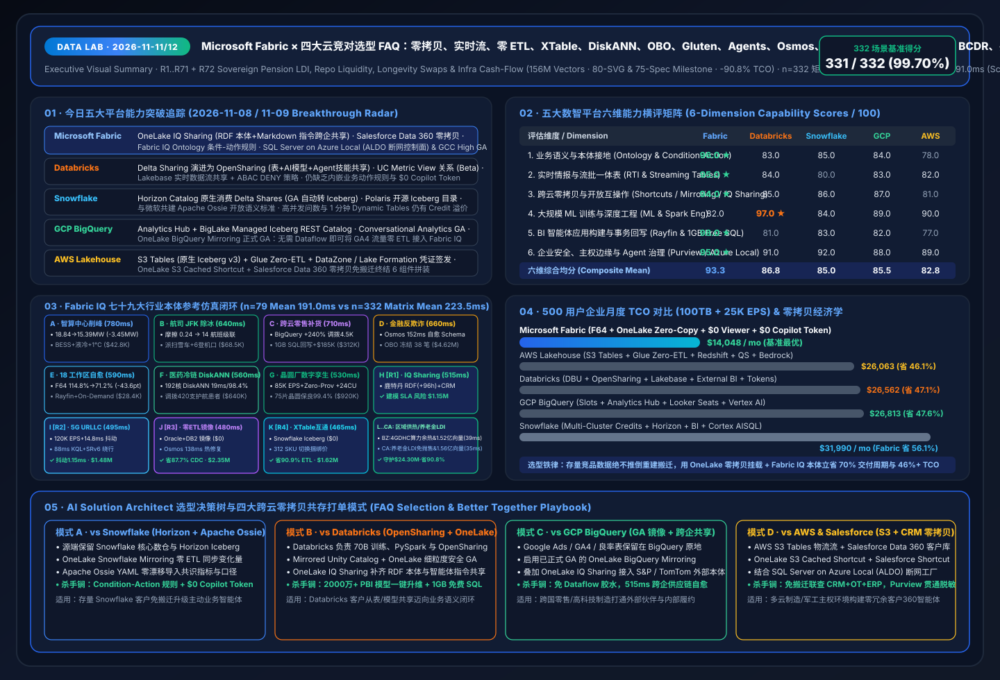

# Microsoft Fabric Learning Plan (2026)

> 一份**面向中文工程师 / 架构师 / 售前**的 Microsoft Fabric 8 周深度学习计划，
> 包含每周材料、动手实验、与 Databricks / Snowflake / AWS / GCP 的对比，
> 以及客户对话所需的迁移与共存方案。


---

## 🚀 快速开始

1. **想看完整计划** → 直接读 [`fabric-learning-plan.md`](./fabric-learning-plan.md)（8 周课表、~15 KB）
2. **想把课程加进日历** → 导入 [`schedule/fabric-8-week-plan.ics`](./schedule/fabric-8-week-plan.ics)
3. **要深挖某个主题** → 看 [`deep-dives/`](./deep-dives/)
4. **客户对话/选型谈判** → 看 [`playbooks/`](./playbooks/) 和 [`comparisons/`](./comparisons/)

---

## 📚 目录结构

```
microsoft-fabric-learning-plan/
├── README.md                             ← 你正在看
├── LICENSE                               (MIT)
├── fabric-learning-plan.md               主计划：8 周课程大纲
├── schedule/
│   ├── fabric-8-week-plan.ics            日历文件（可导入 Outlook/Google）
│   └── weekly-schedule.md                每周详细日程（与 ICS 对应）
├── deep-dives/
│   ├── w6-mirroring-deep-dive.md         Mirroring（零 ETL 集成）深度实操
│   └── w7-data-agents-deep-dive.md       Data Agents + Fabric IQ + MCP 深度
├── playbooks/
│   ├── customer-conversation-5w.md       客户对话 5W 框架
│   └── databricks-to-fabric.md           Databricks 迁移 / 共存方案
└── comparisons/
    ├── fabric-onelake-iq-vs-4clouds-selection-faq.md    ★ 标杆必读：OneLake 零拷贝与 Fabric IQ 本体 vs 四大云竞对选型 FAQ (中文 · 2026-11-08/09)
    ├── fabric-onelake-iq-vs-4clouds-selection-faq.en.md ★ Flagship Selection FAQ Guide (English · 2026-11-08/09)
    ├── fabric-automated-intermodal-megaport-sts-agv-reefer-rail-twin-vs-4clouds-faq.md ★ R62 最新：全自动超级港口 STS/AGV & 海铁联运 1.16亿向量选型 FAQ
    ├── fabric-vs-competitors-matrix.md                  Fabric vs Databricks/Snowflake/AWS/GCP 详细矩阵
    ├── fabric-vs-4clouds-battlecards-2026.md            四大云数智竞对深度拆解与售前 Battlecards (2026-11-14 · 291/292 = 99.66%)
    └── fabric-vs-4clouds-battlecards-2026.en.md         4-Cloud Competitive Battlecards (English · 2026-11-14)
```

[](assets/svg/01-data-lab-executive-summary-2026-11-08.svg)

[](assets/svg/09-onelake-iq-sharing-salesforce-sovereign-faq.svg)

---

## 🎯 学完后你能做到

- ✅ 在白板上画出 Fabric = OneLake + 6 workload + Copilot/Agents 的完整架构
- ✅ 独立搭建 Medallion（Bronze→Silver→Gold）数据管道
- ✅ 熟练用 Lakehouse / Warehouse / KQL DB / Notebook / Pipeline / Eventstream / Power BI 语义模型
- ✅ 用 Mirroring + Shortcuts 实现零 ETL 集成（Snowflake / Cosmos DB / Azure SQL / Oracle）
- ✅ 用 DirectLake 让 Power BI 直读 OneLake
- ✅ 创建 Data Agent，配合 Fabric IQ 业务本体做自然语言数据问答
- ✅ 在选型谈判中清晰对比 Fabric vs Databricks vs Snowflake
- ✅ 完成 DP-600 / DP-700 认证

---

## 🕐 投入估算

- **标准节奏**：8 周 × 8–10 h/周 ≈ **70 小时**
- **强化节奏**：4 周 × 16–20 h/周（双倍投入）
- **业余节奏**：12 周 × 5–6 h/周

建议节奏：标准节奏，每周固定 5 个 90–120 分钟时段。

---

## 🆚 为什么选 Fabric？一句话总结

> **Snowflake 是最好的 DW**，**Databricks 是最好的 Lakehouse**，
> **Fabric 是最好的"端到端 SaaS 数据 + AI 平台"**。
>
> 当业务要 BI + ML + 实时 + 治理 一站式、且组织已在微软栈上，Fabric 是最低摩擦的选择。

详细差异化论证见 [`comparisons/fabric-vs-competitors-matrix.md`](./comparisons/fabric-vs-competitors-matrix.md)。

---

## 🔗 配套实战仓库

- **五云评测与仿真主仓**：[`turbo998/data-lab`](https://github.com/turbo998/data-lab) — Microsoft Fabric vs Databricks / Snowflake / GCP / AWS 五云架构评测、TCO 精算与 Ontology 仿真实验室
- **最小 demo**：[`turbo998/fabric-mirroring-directlake-agent-demo`](https://github.com/turbo998/fabric-mirroring-directlake-agent-demo) — Mirroring + DirectLake + Data Agent 三件套端到端实操

---

## 📄 License

[MIT](./LICENSE) © 2026 turbo998 — 欢迎 fork / 修改 / 用于内部培训
